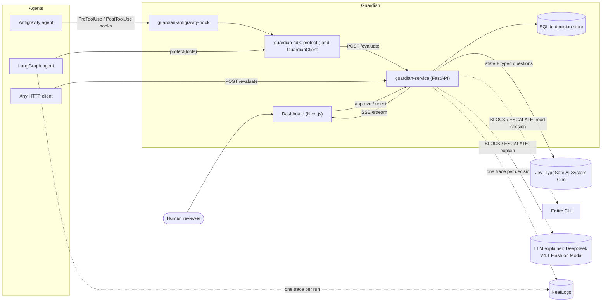
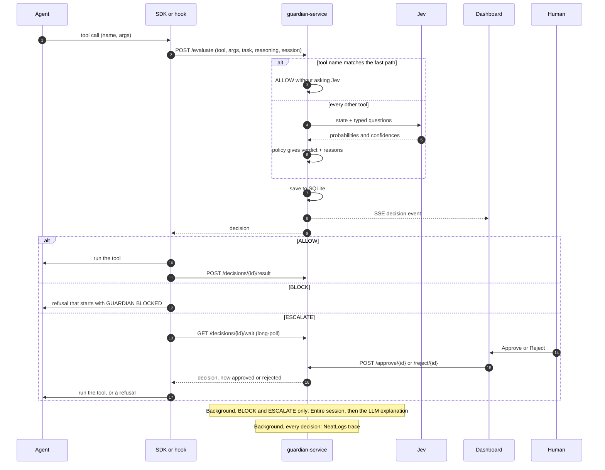
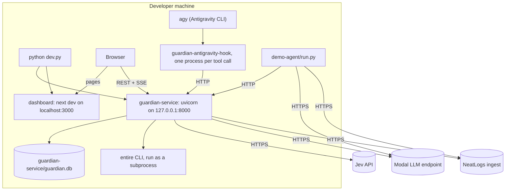

# Guardian architecture: high-level design

This is the five-minute overview. The precise reference (module map, data model, API contract, the Jev request, every policy rule, trace payloads, SDK and hook internals, storage, configuration and tests) is the **[low-level design](ARCHITECTURE-LOW-LEVEL.md)**.

## What Guardian is

AI agents call tools that change real things: they run shell commands, write files and send HTTP requests. One wrong call, such as `rm -rf ./*` or a request that uploads a secret, can't be undone.

Guardian is a checkpoint that sits between an agent and its tools. Before a tool call runs, the agent sends it to Guardian. Guardian asks **Jev** (TypeSafe AI's System One decision model) a fixed set of typed questions about the call, turns the answers into a verdict with a configurable policy, and returns one of three answers:

- **ALLOW**: run the tool.
- **BLOCK**: don't run it. The agent gets a refusal with Guardian's reasons and has to choose another approach.
- **ESCALATE**: pause the agent until a human approves or rejects the call in the dashboard.

Design rules that shape everything below:

1. The agent waits only for Jev and the policy. Session lookup, explanations and tracing run after the verdict.
2. Guardian never guesses. If Jev can't answer, the call goes to a human.
3. Every decision is stored with Jev's raw answers, so a policy change can be replayed against real history before it ships.
4. Integrations other than Jev are optional. Each shows as `off` until configured; nothing is simulated.

## System context

Solid lines are on the agent's critical path. Dotted lines run in the background.

| External system | What Guardian uses it for |
|---|---|
| **Jev** (TypeSafe AI System One) | The decision model. One `system_one` request per checked tool call, through the official `typesafe-sdk`. Any host that serves the same API works (`JEV_BASE_URL`): TypeSafe directly, OpenCode Zen, OpenRouter, or a third-party host. |
| **NeatLogs** | Observability. One trace per decision, one per example-agent run, and one per replay comparison, sent to the HTTP ingest. |
| **Entire CLI** | The agent's captured session (prompts, transcript, checkpoint), read for BLOCK and ESCALATE decisions so the explanation can say *why* the agent tried the call. |
| **LLM explainer** | Turns a decision and its Entire session into three plain-English lines. Configured for DeepSeek V4.1 Flash on a Modal endpoint; any OpenAI-compatible `/chat/completions` endpoint works. The example agent uses the same endpoint as its planner. |
| **Antigravity** | An agent host. Guardian plugs into its documented hook system. |
| **Human reviewer** | Decides ESCALATE calls in the dashboard. |

## Components

| Component | Path | Responsibility | Runs as |
|---|---|---|---|
| guardian-service | [`guardian-service/app/`](../guardian-service/app) | Evaluates calls (Jev + policy), stores and streams decisions, resolves escalations, enriches decisions in the background. Also ships two CLIs: `doctor` (checks each integration with a real call) and `replay` (re-scores history offline). | One uvicorn process with one asyncio event loop |
| guardian-sdk | [`guardian-sdk/guardian/`](../guardian-sdk/guardian) | `GuardianClient` (calls `/evaluate`, long-polls escalations, reports results), `protect()` (wraps LangChain / LangGraph tools), and the `guardian-antigravity-hook` command | A library inside the agent's process. The hook is one short-lived process per tool call. |
| dashboard | [`dashboard/`](../dashboard) | Next.js 16, React 19 and Tailwind 4. Reads `/health` and `/decisions`, listens to `/stream`, approves and rejects, asks for explanations on demand. Pages: setup, home, decisions, approvals, sessions, policy, integrations. | `next dev` on port 3000. The browser calls the service directly. |
| demo-agent | [`demo-agent/`](../demo-agent) | Example LangGraph agent. The LLM endpoint plans and Guardian guards every tool. Its tools are sandboxed to `demo-agent/workspace`, and each run is sent to NeatLogs as one trace. | `python dev.py demo <example>` |
| dev.py | [`dev.py`](../dev.py) | `setup`, `doctor`, run service + dashboard, `install-antigravity`, `demo`, `replay`, `test` | Developer CLI |

Inside the service, [`guardian.py`](../guardian-service/app/guardian.py) orchestrates. [`policy.py`](../guardian-service/app/policy.py) is a pure function from Jev's signals to a verdict. Each external system has one adapter in [`adapters/`](../guardian-service/app/adapters).

## One decision

## Main flows

| Flow | Verdict and first status | What happens next |
|---|---|---|
| **ALLOW** | `ALLOW`, `allowed` | The tool runs. The client reports the outcome with `POST /decisions/{id}/result`: the SDK sends the output or error, and the Antigravity hook's PostToolUse sends whether it failed. |
| **BLOCK** | `BLOCK`, `blocked` | The tool doesn't run. The agent receives Guardian's reasons as the tool's output (SDK) or as the `deny` reason (Antigravity). A blocked call can't be approved later. |
| **ESCALATE** | `ESCALATE`, `pending` | The client long-polls. A human approves (`approved`, the tool runs) or rejects (`rejected`). If nobody answers within `GUARDIAN_ESCALATION_TIMEOUT` (300 s) the service marks it `expired` and the tool doesn't run. |
| **Handoff** | `pending` to `handed_off` | The Antigravity hook stops waiting after `GUARDIAN_HOOK_WAIT` (240 s), tells the service, and answers `force_ask`, so Antigravity's own approval prompt asks the user. |
| **Read-only fast path** | `ALLOW`, `allowed` | Tool names that fully match the `GUARDIAN_FAST_PATH_TOOLS` regex are allowed without a Jev call. The decision is still stored, streamed and traced, with `checked: false`. The code default is empty (every tool checked). `.env.example` sets `read_file`. |
| **Jev unreachable** | `ESCALATE`, `pending` | A timeout, network error, API error or unusable answer becomes an escalation with confidence 0 and the error recorded. The policy never runs on missing answers. |

The waits fit together. The hook gives up (240 s) before the service expires the escalation (300 s), so Antigravity's prompt still gets the question. The SDK's default `approval_timeout` is 600 s, so a LangGraph agent normally sees `expired` from the service first.

## Synchronous and background work

| Before `POST /evaluate` returns (the agent waits) | After it returns (background tasks) |
|---|---|
| Fill in the session's recent steps if the client sent none | For BLOCK and ESCALATE: read the agent's session with the Entire CLI (if it's on `PATH`) |
| Fast-path check | For BLOCK and ESCALATE: generate the explanation (if an LLM endpoint is configured) |
| One Jev call: 5 s per HTTP request, at most one retry, 8 s budget in total | Send the NeatLogs trace (if a key is set), up to three attempts |
| Policy | For ESCALATE: a timer that expires the decision after 300 s |
| Save to SQLite and publish an SSE event | |

Each background step updates the stored decision and publishes another SSE event, so the dashboard fills in the explanation and the trace link as they arrive. A failed background step is logged and recorded on the decision. It never changes the verdict.

## Deployment view

Guardian runs on the developer's machine. Only the external APIs are remote.

| Piece | Where | Notes |
|---|---|---|
| Service | `GUARDIAN_HOST:GUARDIAN_PORT`, default `127.0.0.1:8000` | Started by `python dev.py` together with the dashboard. Interactive API docs at `/docs`. |
| Dashboard | `localhost:3000` | The browser calls the service at `NEXT_PUBLIC_GUARDIAN_URL`. The service's CORS rule allows only `localhost` and `127.0.0.1` origins. |
| Decision store | `GUARDIAN_DB_PATH`, default `guardian-service/guardian.db` | One SQLite file in WAL mode, one JSON row per decision. |
| Entire CLI | On `PATH` (`ENTIRE_BIN`) | Run inside the agent's project folder. |
| Antigravity hook | `<project>/.agents/hooks.json` | Written by `python dev.py install-antigravity <project>`, which keeps other entries such as Entire's. |
| Configuration | `.env` at the repo root | Template: [`.env.example`](../.env.example). Only `JEV_API_KEY` is required. |
| Evidence files | `evidence/runs/`, `evidence/replays/` | Written by the example agent and by `replay --save`. |

## Failure behaviour

| What fails | Effect on the agent | What is recorded |
|---|---|---|
| Jev (timeout, network, API error, unusable answer) | ESCALATE: a human decides | `jev_error`, and a reason saying Jev couldn't be reached |
| `JEV_API_KEY` missing | The service refuses to start | Startup log |
| LLM explainer | None | `explanation_error` on the decision |
| Entire (CLI missing, no repository, no session) | None | `entire` is empty or holds an error. The explanation is written without session context. |
| NeatLogs ingest | None | The trace payload is kept with `mode: "error"`. 5xx and network errors are retried. `POST /traces/retry` re-sends failed traces later. |
| Guardian service down or answering with an HTTP error (SDK) | The call is refused with `GUARDIAN UNAVAILABLE`, unless the client was built with `fail_open=True` | Nothing |
| Guardian service down or answering with an HTTP error (Antigravity hook) | `force_ask`: Antigravity asks the user | Nothing |
| The hook raises an exception | `force_ask` for PreToolUse, `{}` for PostToolUse. The hook always prints one JSON answer and exits 0, because Antigravity denies the call when a hook fails. | Nothing |
| Service restart while an escalation is pending | The decision stays `pending`. Its expiry timer was in memory, so only a human or a handoff can resolve it. | The stored decision |
| One SSE client stops reading | After 500 unread events it is dropped from the broadcast and gets no more events on that connection | Nothing. The dashboard refetches `/decisions` whenever its stream reconnects. |

## Trust boundaries

- **Guardian is opt-in for the agent.** It checks only calls that go through the SDK wrapper, the Antigravity hook, or a direct `POST /evaluate`. A tool called another way isn't checked. Community reports say Antigravity's `--dangerously-skip-permissions` mode skips hooks.
- **The client is trusted to describe the call.** Tool name, arguments, task and reasoning come from the agent. The agent's reasoning reaches Jev only as part of the state being judged.
- **The API has no authentication.** Anyone who can reach the port can evaluate, approve, reject or clear history. The defaults limit this to the local machine: the service binds to `127.0.0.1`, and CORS allows only `localhost` and `127.0.0.1` origins.
- **Data leaves the machine.** Tool arguments (each string cut to 2,000 characters), the task, the reasoning and recent steps go to Jev. The decision and an excerpt of the Entire session go to the LLM endpoint. The tool arguments, Jev's state and answers, the Entire excerpt and the explanation go to NeatLogs. Guardian doesn't redact secrets in tool arguments.
- **Keys** are read from `.env` and sent only to their own service: the Jev key to `JEV_BASE_URL`, the Modal token to `LLM_BASE_URL`, the NeatLogs key to the ingest URL.
- **A human has the final say only on ESCALATE.** Approve and reject act only on `pending` decisions, so a BLOCK can't be overridden through the API.
- **The example agent's sandbox doesn't depend on Guardian.** Its file tools stay inside `demo-agent/workspace`, `run_shell` allows only `ls`, `cat`, `echo` and screened Python scripts, and `http_request` sends only GET requests.

## How each sponsor tool is used

| Tool | Role in Guardian | When it's called | Code | If it's not configured |
|---|---|---|---|---|
| **Jev** (TypeSafe AI System One) | Answers five typed questions about each call: `safe` (Noul), `on_task` (Noul), `risk` (Choice), `severity` (Score), and `output_ok` (Noul, only when the call writes content). The policy reads the probabilities and confidences. | Synchronously, for every call outside the fast path | [`jev_client.py`](../guardian-service/app/adapters/jev_client.py), [`policy.py`](../guardian-service/app/policy.py) | Required. The service won't start without a key. If Jev can't be reached, the call escalates. |
| **NeatLogs** | Decision trace: `WORKFLOW` root, then `GUARDRAIL` (Jev), `CHAIN` (policy), `RETRIEVER` (Entire) and `LLM` (explainer) spans. Agent run trace: `LLM` and `TOOL` spans with a `GUARDRAIL` per checked call. Replay trace: one `EVALUATOR` span per decision. Traces in one agent session share `neatlogs.session.id`. | In the background, after each decision. After each example-agent run. On `replay --trace`. | [`neatlogs_tracer.py`](../guardian-service/app/adapters/neatlogs_tracer.py), [`run_trace.py`](../demo-agent/run_trace.py), [`replay.py`](../guardian-service/app/replay.py) | `off`: no traces |
| **Entire** | `entire session info <id> --json` (or `session current`), the session transcript, and `entire checkpoint explain HEAD`, run in the agent's project folder. For Antigravity, the conversation ID is used as the Entire session ID. | In the background, for BLOCK and ESCALATE, and for on-demand explanations | [`entire_client.py`](../guardian-service/app/adapters/entire_client.py) | `off`: explanations have no session context |
| **DeepSeek V4.1 Flash on Modal** | Writes three lines: what the agent tried, why it did it, and why Guardian stepped in, with a safer alternative. Also the example agent's planner. | In the background, for BLOCK and ESCALATE, and on demand from the dashboard | [`explainer.py`](../guardian-service/app/adapters/explainer.py), [`agent.py`](../demo-agent/agent.py) | `off`: no explanations, and the example agent won't start |

## Supporting tools

- **Replay** (`python dev.py replay`) re-scores stored decisions with the current thresholds and fast path, without calling Jev. It shows which verdicts would change, and how many Jev calls and escalations the change saves.
- **Doctor** (`python dev.py doctor`) makes one real Jev call and one real LLM call, and checks for the `entire` and `agy` CLIs.
- **Tests** (`python dev.py test`, 84 tests) run offline. Jev, NeatLogs, the LLM and Entire are replaced by test stand-ins. Several suites start a real Guardian server.
