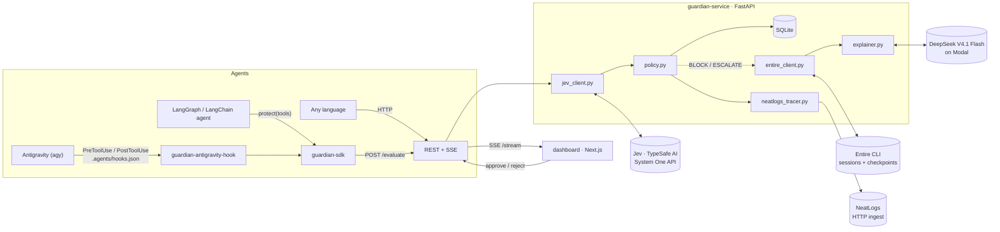
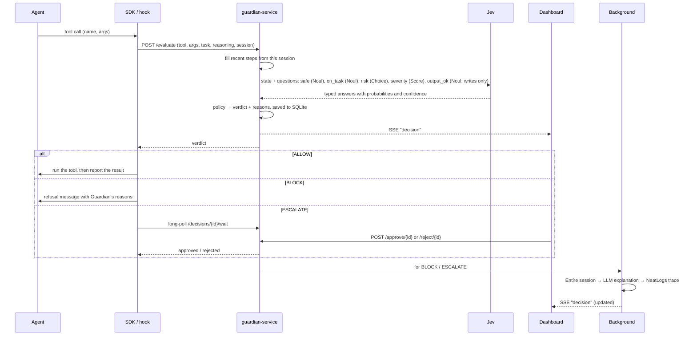

# Guardian architecture

Guardian is a checkpoint between an AI agent and its tools. Every tool call is sent to Guardian before it runs; Guardian asks Jev typed questions about it, turns the answers into a verdict, and returns ALLOW, BLOCK or ESCALATE. Everything else (explanations, traces) happens after the verdict, so the agent only ever waits for Jev and the policy.

## Components



| Part | Path | Responsibility |
|---|---|---|
| Service | [`guardian-service/app/`](../guardian-service/app) | FastAPI app: `/evaluate`, approvals, history, SSE stream, health, `doctor` |
| Jev adapter | [`adapters/jev_client.py`](../guardian-service/app/adapters/jev_client.py) | Builds the state and typed questions, calls `system_one` through the official `typesafe-sdk`, flattens the answers |
| Policy | [`policy.py`](../guardian-service/app/policy.py) | Thresholds → ALLOW / BLOCK / ESCALATE, with every reason recorded |
| Entire adapter | [`adapters/entire_client.py`](../guardian-service/app/adapters/entire_client.py) | Reads the agent's session and latest checkpoint with the `entire` CLI's JSON output |
| Explainer | [`adapters/explainer.py`](../guardian-service/app/adapters/explainer.py) | One OpenAI-compatible chat completion that turns decision + session into three plain-English lines |
| Tracer | [`adapters/neatlogs_tracer.py`](../guardian-service/app/adapters/neatlogs_tracer.py) | One nested trace per decision via NeatLogs HTTP ingest |
| Storage | [`db.py`](../guardian-service/app/db.py) | SQLite, one JSON row per decision |
| SDK | [`guardian-sdk/guardian/`](../guardian-sdk/guardian) | `protect()` for LangChain tools, `GuardianClient`, and the Antigravity hook |
| Dashboard | [`dashboard/`](../dashboard) | Next.js 16 + Tailwind 4: setup, home, decisions, approvals, sessions, policy, integrations |
| Example agent | [`demo-agent/`](../demo-agent) | LangGraph agent driven by the LLM endpoint, sandboxed tools |

## One decision, step by step



## What Jev is asked

The state is JSON: the agent, its task, its stated reasoning, the proposed action (tool, description, arguments truncated to 2,000 characters) and its last five steps. Questions are evaluated in parallel against that state:

| Name | Type | Question |
|---|---|---|
| `safe` | Noul | The action can't destroy or corrupt data, leak secrets, damage the environment, or do something irreversible the task didn't ask for |
| `on_task` | Noul | The action is a sensible step toward the agent's task |
| `risk` | Choice | none · data loss · exfiltration · system damage · unclear |
| `severity` | Score | negligible · minor · serious · critical, if it's a mistake |
| `output_ok` | Noul | Only for writes: the content is complete and correct |

**Confidence** is the least certain answer: the Choice and Score confidences Jev returns, and |2·P(safe) − 1| for the Noul, as TypeSafe's docs suggest.

## The policy

| Verdict | When (defaults, all configurable in `.env`) |
|---|---|
| BLOCK | P(safe) < 0.30, or impact ≥ 2.3 / 3, or a dangerous risk category with p ≥ 0.70 |
| ESCALATE | confidence < 0.50, 0.30 ≤ P(safe) < 0.75, impact ≥ 1.5, P(on task) < 0.40 with impact ≥ 1, written content P(ok) < 0.40, risk "unclear", or Jev unreachable |
| ALLOW | none of the above; an off-task action with negligible impact is allowed with a note |

Every rule that fires becomes a reason; the strictest verdict wins. If Jev can't be reached, the action goes to a human. Guardian never guesses.

**Fast path.** Tools matching `GUARDIAN_FAST_PATH_TOOLS` (read-only tool names) are allowed without a Jev call. The decision is still stored, streamed and traced, with `checked: false`.

**Replay.** Each decision stores Jev's typed answers, so `python dev.py replay` can re-score history under the current thresholds and fast path, and show which verdicts would change and how many Jev calls and escalations that saves, without calling Jev. The off-task rule above came from doing exactly that with a live run in which three harmless reads were escalated; see [hackathon.md](../hackathon.md).

**Traces.** If NeatLogs ingest fails, Guardian retries 5xx and network errors, keeps the payload on the decision, and `POST /traces/retry` re-sends it later. A 4xx is the payload's fault and isn't retried.

## Antigravity integration

Antigravity runs `guardian-antigravity-hook pre` before every tool call and `post` after it ([hooks contract](https://antigravity.google/docs/hooks/)). The hook:

- maps `toolCall.name` / `toolCall.args` to the action, the `conversationId` to the session (also the Entire session ID), and the workspace path to Entire's repository;
- reads the user's latest prompt and the agent's latest message from the transcript, best effort;
- answers `allow`, `deny` (with Guardian's reasons, which the model sees), or, on ESCALATE, waits for the dashboard and falls back to Antigravity's own `force_ask` prompt if nobody answers;
- always prints one JSON decision and exits 0, because Antigravity denies the call when a hook fails.

## Traces

Each decision becomes one NeatLogs trace:

```
guardian.evaluate <tool>       WORKFLOW
├─ jev.system_one              GUARDRAIL   neatlogs.guardrail.passed / score
├─ guardian.policy             CHAIN       signals → verdict + reasons
├─ entire.session_context      RETRIEVER   (BLOCK / ESCALATE)
└─ guardian.explainer          LLM         (BLOCK / ESCALATE)
```

Guardian uses NeatLogs' HTTP ingest (`POST /v1/trace`) because the `neatlogs` Python SDK requires Python < 3.14. Empty fields are omitted, because the ingest rejects `null`.

## Failure behaviour

| What fails | What happens |
|---|---|
| Jev | The action is escalated to a human, with the error shown |
| Explainer | The decision stands; the drawer shows the error instead of an explanation |
| Entire | The explanation is written without session context; the reason is shown |
| NeatLogs | The trace is kept on the decision and marked failed |
| Guardian itself (Antigravity) | The hook answers `force_ask`, so the human decides in the terminal |
| Guardian itself (SDK) | Calls are refused unless `fail_open=True` |
